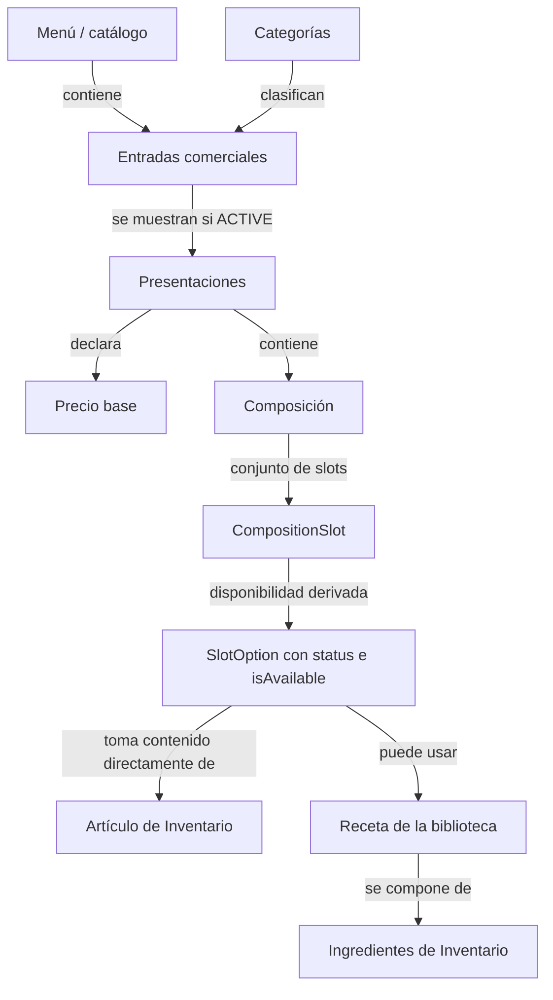
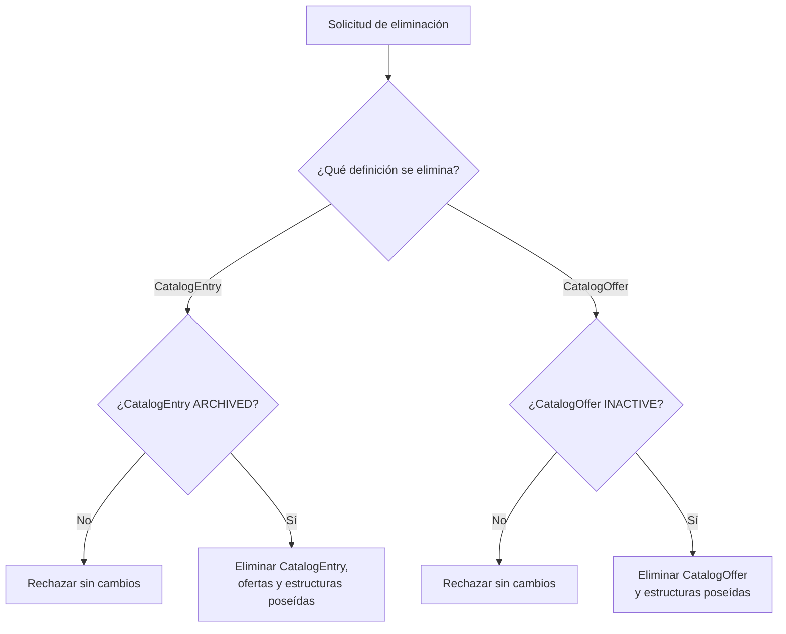
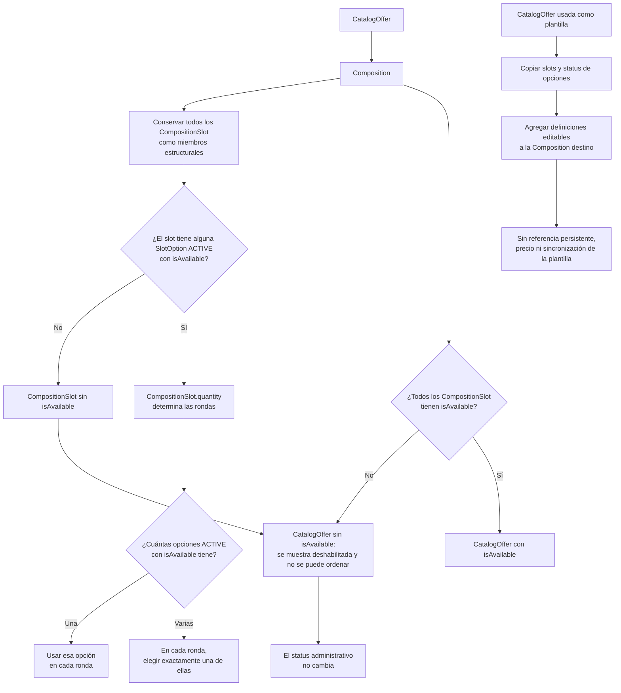
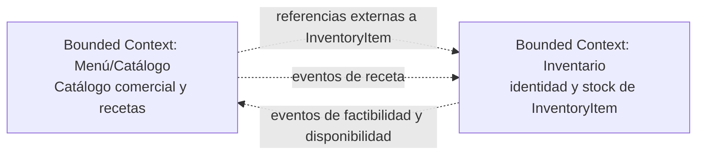

# Arquitectura de Dominio del Servicio Menu

## Modelo de Dominio

El modelo de Menú/Catálogo describe categorías, entradas comerciales, ofertas, composiciones, slots, opciones de contenido y recetas. Menu contiene categorías y entradas; Category clasifica CatalogEntry; y CatalogEntry administra el nombre comercial y sus categorías, y contiene sus CatalogOffer. Cada CatalogOffer concreta es seleccionable y vendible de forma individual. Una entrada ACTIVE se muestra aunque no tenga ofertas disponibles, y entonces aparece deshabilitada; el status de sus ofertas no cambia el status de la entrada.

Toda oferta vendible posee una Composition con uno o más CompositionSlot; la composición es el conjunto de slots y todos son miembros estructurales. El slot no tiene status: su isAvailable depende de que al menos una SlotOption ACTIVE tenga isAvailable. Todos los slots son obligatorios y participan; `CompositionSlot.quantity` determina las rondas de cada slot. CatalogOffer tiene isAvailable solo si todos sus slots lo tienen, y su status solo lo cambia el administrador. En cada ronda se elige exactamente una opción ACTIVE con isAvailable; cuando hay una sola, se selecciona automáticamente.

Una oferta del catálogo puede usarse como plantilla durante la configuración de otra oferta. Sus slots y opciones se copian a la composición destino como definiciones locales editables, conservando el status de las opciones; la disponibilidad de cada slot se recalcula. La copia conserva los orígenes de Inventario y las referencias a recetas por recipeId, que siguen usando la revisión vigente, pero no conserva la identidad, el precio ni una referencia persistente a la oferta plantilla; los cambios posteriores no se sincronizan.

RecipeLibrary reúne las RecipeDefinition vigentes y el historial de revisiones de cada receta. Cada receta contiene instrucciones textuales y líneas ComponentIngredient que refieren a InventoryItem; Inventario conserva la identidad, la unidad de medida y el stock de esos artículos. La selección de una receta para una SlotOption indica solo su ID, y la opción usa siempre la revisión vigente de esa receta; editarla crea una revisión nueva que las opciones vigentes usan de inmediato.

## Agregados y Límites de Consistencia

Las relaciones siguientes expresan propiedad y composición conceptual del modelo. No prescriben agregados transaccionales, persistencia ni claves físicas.

### Menú y catálogo comercial

Menu contiene categorías y entradas comerciales. Category clasifica cero o más CatalogEntry y una entrada puede clasificarse en varias categorías del mismo menú. CatalogEntry es la identidad comercial con nombre autoritativo, descripción, estado, imagen y sus CatalogOffer, cada una vendible y seleccionable individualmente. Una entrada puede administrarse incompleta o inactiva; si está ACTIVE sin una CatalogOffer ACTIVE disponible, se muestra deshabilitada. Archivar una entrada puede hacerse desde ACTIVE o INACTIVE; desarchivarla siempre la deja INACTIVE. El status de una oferta no modifica el status de la entrada.

### Oferta y composición

CatalogEntry contiene CatalogOffer; cada oferta concreta puede seleccionarse individualmente. Una CatalogEntry ACTIVE se muestra con sus CatalogOffer ACTIVE; su status no depende de sus ofertas. Una oferta solo se muestra mientras su entrada esté ACTIVE y solo se activa con una Composition válida. CatalogOffer posee exactamente una Composition y su basePrice describe el precio fijo de esa oferta. Su nombre visible combina el nombre comercial de la entrada con la presentación obligatoria; presentationTag es descriptiva y no determina cantidades físicas.

Composition es el conjunto de uno o más CompositionSlot y todos permanecen como miembros estructurales de la oferta. Cada slot contiene una o más SlotOption, opciones de contenido que poseen un origen único. Todos los slots participan; basta un slot sin isAvailable para que la oferta no tenga isAvailable, sin que cambie su status. Usar una oferta como plantilla copia los slots y el status de sus opciones a otra composición sin conservar relación con la oferta de origen.

RecipeLibrary contiene las definiciones vigentes y su historial de revisiones. Cada RecipeSource conserva solo el ID de la receta seleccionada y usa su revisión vigente. InventoryItem, su unidad de medida y su stock siguen bajo Inventario.

Una receta vigente solo puede eliminarse cuando ninguna SlotOption de ninguna oferta la referencia, incluso si la oferta o la opción está inactiva. Si existe una referencia, se rechaza la eliminación sin cambios; el historial de revisiones de la receta permanece consultable.

Una CatalogEntry solo puede eliminarse desde ARCHIVED. Una CatalogOffer solo puede eliminarse individualmente desde INACTIVE; la disponibilidad no interviene. No hay referencias vigentes de una oferta a otra que restrinjan estas eliminaciones. Al eliminar una entrada, las ofertas y estructuras poseídas se retiran con ella.

## Entidades y Atributos Principales

La siguiente tabla resume los 14 conceptos del modelo, sus responsabilidades, atributos y relaciones. CatalogEntry declara status ACTIVE, INACTIVE o ARCHIVED; CatalogOffer y SlotOption declaran ACTIVE o INACTIVE. CompositionSlot no tiene status. CatalogEntry, CatalogOffer, CompositionSlot y SlotOption tienen isAvailable derivado (BR-MENU-032). Los identificadores son conceptuales: no prescriben claves de base de datos ni un esquema de almacenamiento.

| Entidad o concepto | Responsabilidad | Atributos y relaciones principales |
| :--- | :--- | :--- |
| Menu | Propietario del conjunto de categorías y entradas comerciales. | id, name, currency; contiene Category y CatalogEntry. |
| Category | Categoría reutilizable que clasifica entradas. | id, menuId, name, description?; name es obligatorio y description es opcional; pertenece a Menu y clasifica cero o más CatalogEntry. |
| CatalogEntry | Identidad comercial que contiene las ofertas de un producto de la carta. | id, menuId, brandName, description, imageRef, status, isAvailable, categoryIds[]; pertenece a Menu, contiene CatalogOffer y usa categorías del mismo menú. Se muestra si está ACTIVE; sin ofertas ACTIVE disponibles aparece deshabilitada. La oferta no cambia el status de la entrada. |
| CatalogOffer | Oferta concreta, individualmente vendible y seleccionable, con precio base y composición propia. | id, entryId, presentationTag, basePrice, status (ACTIVE/INACTIVE, administrativo), isAvailable (derivado), offerImageRef; presentationTag es obligatorio; pertenece a CatalogEntry y contiene exactamente una Composition. Tiene isAvailable solo si todos sus CompositionSlot lo tienen; el status solo lo cambia el administrador. La eliminación individual requiere INACTIVE. |
| Composition | Conjunto de slots que define el contenido configurable de una oferta. | id, offerId, slots[]; pertenece a CatalogOffer, contiene uno o más CompositionSlot y conserva todos como miembros estructurales. |
| CompositionSlot | Slot de una composición que determina sus rondas. | id, compositionId, name, isAvailable (derivado), quantity, course? (entrada, plato fuerte, postre o bebida), options[]; el curso es una sugerencia de tiempo de servicio; pertenece a Composition y contiene una o más SlotOption. Todo slot es obligatorio y participa; tiene isAvailable si al menos una opción ACTIVE lo tiene. |
| SlotOption | Opción de contenido dentro de un slot. | id, slotId, displayName, status, isAvailable, source; pertenece a CompositionSlot y posee un ComponentSource. isAvailable depende de los eventos de Inventario sobre su origen. |
| ComponentSource | Tipo conceptual del origen único de una opción. | type: INVENTORY_ITEM o RECIPE; especialización exclusiva en InventoryItemSource o RecipeSource. |
| InventoryItemSource | Referencia directa a un artículo externo de Inventario. | inventoryItemId, quantity, unit, displayNameSnapshot?; referencia exactamente un InventoryItem. |
| RecipeSource | Referencia interna a una receta de RecipeLibrary desde una SlotOption. | recipeId; la opción usa siempre la revisión vigente de la receta referenciada. |
| InventoryItem | Artículo o ingrediente cuya identidad, unidad de medida y stock son de Inventario. | id, name, baseUnit; concepto externo referenciado por InventoryItemSource y ComponentIngredient. |
| RecipeLibrary | Colección de recetas administradas por Catálogo. | id, name, recipes[]; contiene definiciones vigentes y el historial de revisiones de cada receta. |
| RecipeDefinition | Receta versionada con datos textuales y líneas de ingredientes. | id, name, description, instructions (texto), revision, ingredients[]; pertenece a RecipeLibrary. revision inicia en 1 y aumenta en 1 con cada edición; las revisiones anteriores se conservan como historial. |
| ComponentIngredient | Ingrediente de Inventario incluido en una receta. | id, recipeId, inventoryItemId, quantity, unit; referencia exactamente un InventoryItem. La unidad de Inventario se muestra al seleccionar, consultar o editar. |

### Selección de composición y contenido

Todos los slots pertenecen estructuralmente a la composición; cada slot participa en la selección:

- Una Composition es el conjunto de uno o más CompositionSlot.
- Cada CompositionSlot contiene una o más SlotOption. Su isAvailable es true si al menos una opción ACTIVE tiene isAvailable.
- Todos los slots son obligatorios y participan; basta uno sin isAvailable para que la oferta no lo tenga.
- CompositionSlot.quantity determina cuántas rondas tiene cada slot; la cantidad pertenece al slot, no a cada opción. En cada ronda se elige exactamente una de sus opciones ACTIVE con isAvailable. Por ejemplo, un slot de acompañamientos con quantity 3 tiene tres rondas, eligiendo en cada una entre papas, aros de cebolla o nuggets ACTIVE y disponibles.
- Si un slot tiene una sola opción ACTIVE con isAvailable, se selecciona automáticamente en cada ronda. Si tiene varias opciones elegibles, no se configura una opción predeterminada en el catálogo.
- El status de CatalogOffer solo lo cambia el administrador; la disponibilidad se recalcula y se recupera sola.
- La cantidad de InventoryItemSource expresa la cantidad y unidad física del artículo; no sustituye las rondas definidas por CompositionSlot.quantity.
- course es opcional; cuando se informa, acepta exactamente entrada, plato fuerte, postre o bebida y sugiere un tiempo de servicio.
- Una SlotOption INACTIVE no se presenta como elegible; una ACTIVE sin isAvailable aparece deshabilitada.

### Recetas y precios

Inventario posee la identidad, unidad de medida y stock de InventoryItem. Catálogo administra RecipeLibrary, las definiciones de receta y las cantidades de sus ComponentIngredient. Cada receta se crea con nombre, descripción, instrucciones en texto y una o más líneas de ingredientes seleccionados de Inventario. Cada línea contiene una referencia a InventoryItem y una cantidad; la unidad administrada por Inventario se muestra al seleccionar, consultar o editar el ingrediente. Su precisión, rangos y conversiones se remiten a OPEN-006.

Una SlotOption de tipo RECIPE se configura seleccionando una receta existente de RecipeLibrary solo por ID o definiendo una nueva desde el flujo de configuración. La nueva definición se guarda primero en RecipeLibrary. RecipeSource guarda solo el ID de la receta y la opción usa siempre su revisión vigente. Si la receta no existe, se rechaza la asignación sin cambios parciales. La opción no modifica la receta asignada. Editar una receta crea una revisión nueva, con el número siguiente, que pasa a ser la vigente y que las opciones vigentes usan de inmediato; las revisiones anteriores quedan como historial. Omitir recipeId al editar una opción que ya usa RECIPE conserva la receta asignada.

La definición vigente de una receta solo puede eliminarse cuando ninguna SlotOption de ninguna oferta la referencia, aunque la oferta o la opción esté inactiva. Si hay una referencia, se rechaza la operación sin cambios; se conserva el historial de revisiones de la receta. INVENTORY_ITEM referencia directamente un artículo externo.

CatalogOffer.basePrice es fijo para la oferta, independientemente de los slots y contenidos elegidos. Ni CompositionSlot, SlotOption ni las definiciones copiadas de otra oferta aportan cargos automáticos a ese precio. El modelo no calcula el precio final de una orden.

### Diagramas Estructurales y de Comportamiento

#### Vista conceptual del catálogo (para Front)

Cada opción tiene un único origen de contenido: un artículo de Inventario o una receta de la biblioteca. La vista conceptual resume cómo se organiza el catálogo:

Inventario conserva la identidad de los artículos, sus unidades y existencias. Menú/Catálogo administra las ofertas comerciales y la biblioteca de recetas; cada opción de tipo RECIPE selecciona la receta solo por ID y usa siempre su revisión vigente. Todos los slots participan en la selección; la disponibilidad de la oferta exige que todos estén disponibles. Menú declara el precio base de cada presentación; no calcula el precio final de la orden.

#### Vista técnica: diagrama de clases del dominio comercial (para Back)

La vista técnica detalla el mismo modelo comercial representado en la vista conceptual. La composición representa pertenencia conceptual; las asociaciones y dependencias representan referencias y no prescriben claves foráneas.

Todas las RecipeDefinition vigentes pertenecen a RecipeLibrary, que conserva el historial de sus revisiones. Cada ComponentIngredient referencia exactamente un InventoryItem, conserva su cantidad y muestra la unidad que administra Inventario. RecipeSource guarda solo el ID de la receta, y la opción usa la revisión vigente.

#### Estados comerciales

CatalogEntry declara status ACTIVE, INACTIVE o ARCHIVED. El archivado es reversible: una entrada puede archivarse desde ACTIVE o INACTIVE y al desarchivarse queda INACTIVE. CatalogOffer y SlotOption declaran un status administrativo ACTIVE o INACTIVE; CompositionSlot carece de status. Los cuatro recursos tienen isAvailable derivado: la opción según los eventos de Inventario, el slot si alguna opción ACTIVE está disponible, la oferta si todos sus slots lo están y la entrada si alguna oferta ACTIVE lo está. Lo ACTIVE se muestra y lo que no tiene isAvailable aparece deshabilitado y no se puede ordenar. Solo el administrador cambia un status; la disponibilidad nunca lo modifica. course es opcional y, cuando se informa, acepta exactamente entrada, plato fuerte, postre o bebida como sugerencia de tiempo de servicio; no es un estado de marcha.

Una CatalogEntry solo puede eliminarse desde ARCHIVED. Una CatalogOffer solo puede eliminarse individualmente desde INACTIVE. Las ofertas no mantienen referencias vigentes entre sí. Si la condición de status falla, la operación se rechaza íntegramente. Cuando procede, se retiran el recurso y sus estructuras poseídas.

#### Selección de una oferta y copia de una composición

El diagrama separa la pertenencia estructural de la participación en la selección. No define una interfaz ni el contrato de una orden.

La configuración de una oferta concluye al definir su Composition, sus slots y las opciones de contenido. La cantidad pedida y la resolución concreta de elecciones corresponden al modelo de una orden.

## Arquitectura y Límites del Sistema

### Diagrama de Contexto de Bounded Contexts

El límite de Menú/Catálogo contiene las definiciones comerciales y culinarias descritas aquí. Inventario mantiene la identidad de sus artículos y el stock, y comprueba la factibilidad de las recetas y la disponibilidad de los artículos; el catálogo conserva referencias externas a InventoryItem.

La relación expresa que Catálogo referencia identidades cuyo origen y stock pertenecen a Inventario. La comunicación entre ambos contextos es asíncrona, por eventos.

### Patrones de Interacción y Comunicación

El modelo establece datos de catálogo y reglas para describir ofertas, composición y recetas. La cantidad pedida, las elecciones concretas de una orden, asientos, tiempos operacionales de marcha, facturación y cálculo del precio final pertenecen a otros modelos. Menu e Inventario se comunican de forma asíncrona mediante eventos (BR-MENU-034), cuyo contrato queda pendiente en OPEN-011; el documento no selecciona patrones de lectura/escritura, APIs ni tecnologías de transporte.

### Aislamiento Lógico y Reglas de Integración

1. Menu es propietario de sus Category y CatalogEntry. CatalogEntry contiene CatalogOffer; CatalogOffer posee Composition; cada composición es el conjunto de sus CompositionSlot y estos contienen sus opciones SlotOption.
2. Catálogo administra RecipeLibrary, define sus recetas con datos textuales y cantidades de ingredientes, y asigna una receta a SlotOption solo mediante ID; la opción usa siempre la revisión vigente de la receta.
3. Inventario posee la identidad, unidad de medida y stock de InventoryItem. Catálogo referencia InventoryItem mediante identidades explícitas; igualdad numérica entre identificadores de contextos diferentes no establece identidad compartida.
4. La validez estructural de una receta no depende de existencias de Inventario; la factibilidad y la disponibilidad comunicadas por Inventario solo determinan isAvailable. Catálogo no administra el stock externo.
5. CatalogOffer.basePrice es un dato declarado por el catálogo. El dominio no calcula precios finales de pedidos ni suma cargos por slots, opciones o definiciones copiadas.
6. Cada receta se crea con la revisión 1 y cada edición crea una revisión nueva con el número siguiente, que pasa a ser la vigente y que las opciones vigentes usan de inmediato; las revisiones anteriores se conservan como historial consultable. La definición vigente solo se elimina si ninguna SlotOption de ninguna oferta la referencia, y su historial de revisiones se conserva.
7. La eliminación de una CatalogEntry archivada y la eliminación individual de una CatalogOffer inactiva siguen las condiciones de status descritas arriba. Las ofertas no se referencian entre sí.
8. Las relaciones descritas son conceptuales. No prescriben tablas, claves foráneas, APIs, formato de eventos, motor de resolución ni arquitectura de persistencia.
