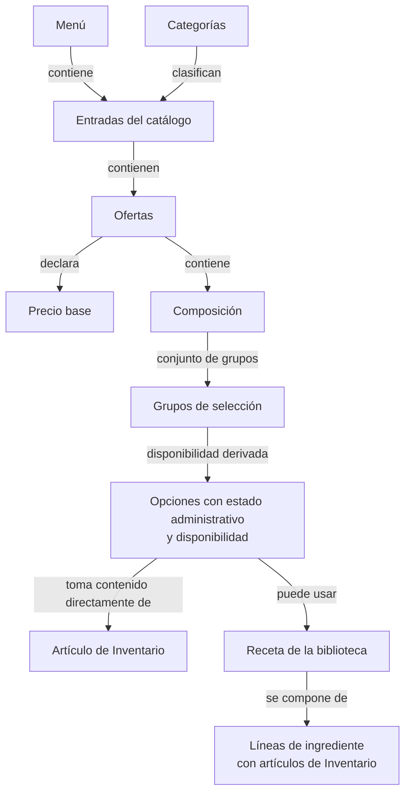
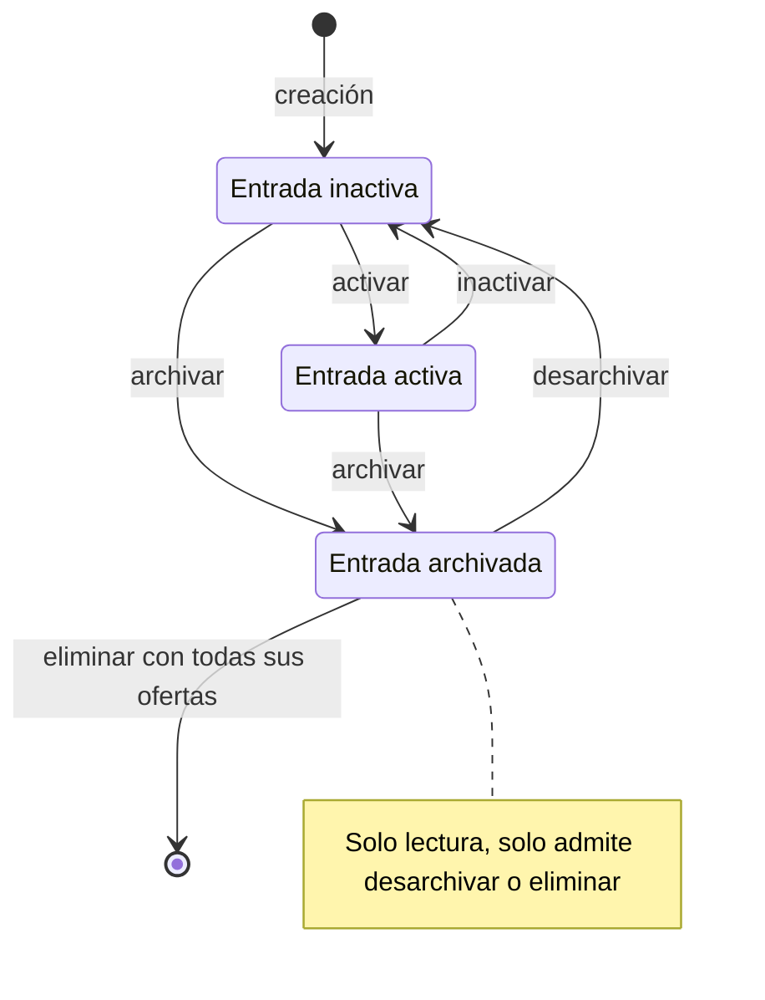
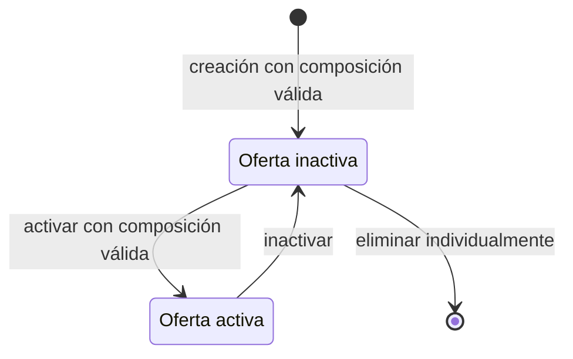
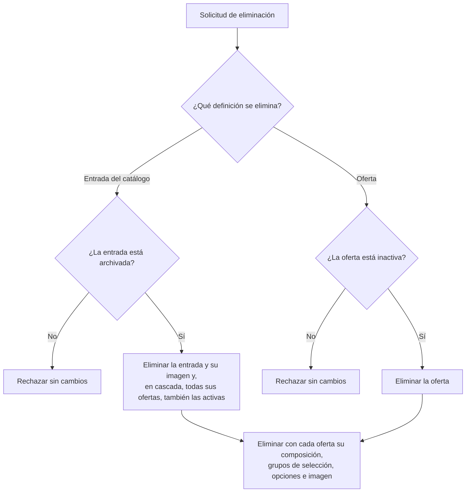
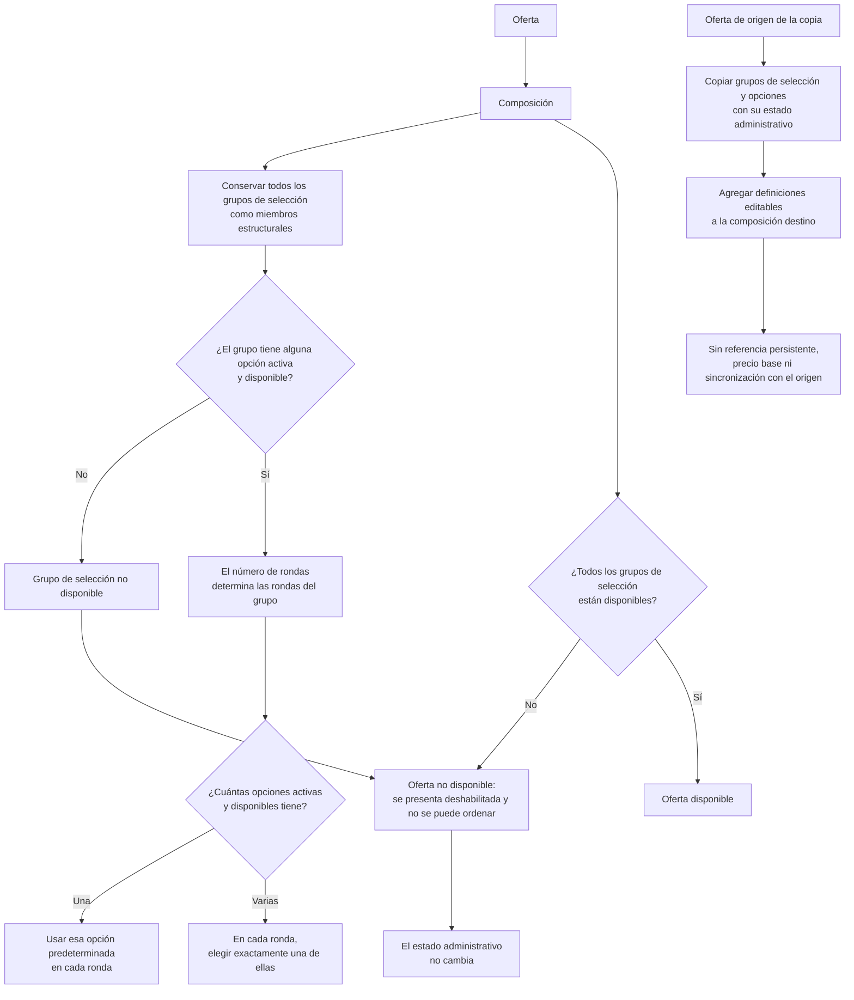
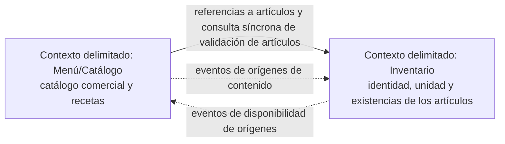

# Arquitectura de Dominio del Servicio Menu

## Modelo de Dominio

El modelo del catálogo describe categorías, entradas del catálogo, ofertas, composiciones, grupos de selección, opciones de contenido y recetas. El menú contiene las categorías y las entradas; las categorías clasifican entradas, y cada entrada conserva su nombre comercial y sus categorías y contiene sus ofertas. Cada oferta es un producto vendible que se selecciona de forma individual. Una entrada activa se presenta aunque no tenga ofertas disponibles, y en ese caso aparece deshabilitada; el estado administrativo de sus ofertas no cambia el de la entrada.

Toda oferta tiene exactamente una composición válida, formada por uno o más grupos de selección que son miembros estructurales y obligatorios de la oferta (RF-COMP-01, RF-COMP-02). El grupo de selección no tiene estado administrativo: está disponible cuando al menos una de sus opciones activas lo está. El número de rondas de cada grupo determina cuántas veces se elige en él. Una oferta está disponible solo si todos sus grupos de selección lo están, y su estado administrativo solo lo cambia el administrador. En cada ronda se elige exactamente una opción activa y disponible; cuando solo hay una, esa opción es la predeterminada (RF-COMP-05, RF-COMP-06).

Una oferta del catálogo puede servir de origen para copiar sus grupos de selección y opciones a la composición de otra oferta. Las copias se agregan a la composición destino como definiciones locales editables y conservan el estado administrativo de las opciones; la disponibilidad de cada grupo se recalcula. La copia conserva los artículos de Inventario y las referencias a recetas por su identificador, que siguen usando la revisión vigente, pero no conserva el identificador, el precio base ni una referencia persistente a la oferta de origen; los cambios posteriores no se sincronizan (RF-COMP-12).

La biblioteca de recetas reúne las recetas vigentes y el historial de revisiones de cada una. Cada receta contiene instrucciones en texto y líneas de ingrediente que referencian artículos de Inventario; Inventario conserva la identidad, la unidad de medida y las existencias de esos artículos. Una opción con receta indica solo el identificador de la receta y usa siempre su revisión vigente; editar la receta crea una revisión nueva que todas las opciones que la referencian usan de inmediato (RF-OPC-09, RF-REC-04).

## Agregados y Límites de Consistencia

Las relaciones siguientes expresan propiedad y composición conceptual del modelo. No prescriben agregados transaccionales, persistencia ni claves físicas.

### Menú y catálogo comercial

El menú contiene categorías y entradas del catálogo. Una categoría clasifica cero o más entradas, y una entrada puede clasificarse en ninguna, una o varias categorías del mismo menú; si no tiene categorías, pertenece a la agrupación «sin categoría» (RF-CAT-04). La entrada es la identidad comercial: conserva el nombre comercial autoritativo, la descripción, el estado administrativo, la imagen y sus ofertas, cada una vendible y seleccionable de forma individual. Una entrada puede administrarse inactiva o sin ofertas; si está activa y no tiene una oferta activa y disponible, se presenta deshabilitada. Una entrada se archiva desde el estado activo o inactivo; mientras está archivada solo admite el desarchivado, que la deja inactiva, o la eliminación (RF-ENT-05, RF-ENT-06). El estado administrativo de una oferta no modifica el de su entrada.

### Oferta y composición

Cada oferta pertenece a una única entrada. Quien consulta el catálogo ve las ofertas activas de las entradas activas; el estado administrativo de la entrada no depende de sus ofertas. Una oferta se crea con una composición inicial válida y solo se activa si su composición es válida (RF-OFE-01, RF-OFE-04). Cada oferta posee exactamente una composición, y su precio base es el precio fijo de la oferta completa. Su nombre visible combina el nombre comercial de la entrada con la etiqueta de presentación obligatoria; la etiqueta de presentación es descriptiva y no determina cantidades físicas.

La composición es el conjunto de uno o más grupos de selección, y todos permanecen como miembros estructurales de la oferta. Cada grupo contiene una o más opciones de contenido, cada una con un único origen de contenido. Todos los grupos participan en la selección; basta un grupo no disponible para que la oferta no esté disponible, sin que cambie su estado administrativo. Copiar la composición de otra oferta agrega sus grupos de selección y opciones, con el estado administrativo de las opciones, sin conservar relación con la oferta de origen.

La biblioteca de recetas contiene las recetas vigentes y su historial de revisiones. Una opción con receta conserva solo el identificador de la receta y usa su revisión vigente. Los artículos de Inventario, su unidad de medida y sus existencias siguen bajo Inventario.

La definición vigente de una receta solo puede eliminarse cuando ninguna opción de ninguna oferta la referencia, aunque la oferta o la opción estén inactivas. Si existe una referencia, la eliminación se rechaza sin cambios; el historial de revisiones de la receta permanece consultable (RF-REC-07).

Una entrada solo puede eliminarse cuando está archivada, y su eliminación elimina en cascada todas sus ofertas, también las activas (RF-ENT-07). Una oferta solo puede eliminarse individualmente cuando está inactiva; la disponibilidad no interviene (RF-OFE-06). Ninguna oferta conserva referencias a otra que restrinjan estas eliminaciones. Con cada oferta eliminada se eliminan su composición, sus grupos de selección, sus opciones y su imagen.

### Selección de composición y contenido

Todos los grupos de selección pertenecen estructuralmente a la composición, y cada uno participa en la selección:

- Una composición es el conjunto de uno o más grupos de selección.
- Cada grupo de selección contiene una o más opciones y está disponible si al menos una de sus opciones activas está disponible.
- Todos los grupos son obligatorios y participan; basta uno no disponible para que la oferta tampoco lo esté.
- El número de rondas pertenece al grupo de selección, no a cada opción, y determina cuántas rondas tiene el grupo. En cada ronda se elige exactamente una de sus opciones activas y disponibles. Por ejemplo, un grupo de selección de acompañamientos con tres rondas permite elegir, en cada una, entre papas, aros de cebolla o nuggets, siempre que estén activos y disponibles.
- Si un grupo tiene una sola opción elegible, esa opción es la predeterminada y se usa en cada ronda. Si tiene varias opciones elegibles, el catálogo no fija ninguna predeterminada.
- Solo el administrador cambia el estado administrativo de una oferta; la disponibilidad se recalcula y se recupera sin intervención administrativa.
- La cantidad del contenido directo de Inventario expresa la cantidad física del artículo en la unidad que Inventario establece para él; no sustituye el número de rondas del grupo de selección.
- El tiempo de servicio es opcional; cuando se indica, solo admite «entrada», «plato fuerte», «postre» o «bebida», y es una sugerencia.
- Una opción inactiva no se presenta a quien consulta el catálogo ni es elegible; una opción activa no disponible aparece deshabilitada.

### Recetas y precios

Inventario posee la identidad, la unidad de medida y las existencias de sus artículos. Menu administra la biblioteca de recetas, las definiciones de receta y las cantidades de sus líneas de ingrediente. Cada receta se crea con nombre, descripción, instrucciones en texto y una o más líneas de ingrediente, cada una con un artículo de Inventario y una cantidad positiva expresada en la unidad que Inventario establece para ese artículo; la línea no tiene unidad propia. La unidad del artículo se muestra al seleccionar, consultar o editar la línea; la precisión y los rangos de la cantidad quedan pendientes en OPEN-006.

Una opción de tipo receta se configura asignándole por su identificador una receta existente de la biblioteca o creando una receta nueva durante la configuración, que se guarda primero en la biblioteca (RF-OPC-09, RF-OPC-10). La opción conserva solo el identificador de la receta y usa siempre su revisión vigente. Si la receta no existe, la asignación se rechaza sin cambios parciales. La opción no modifica la receta asignada. Cada edición aceptada de una receta crea una revisión nueva, con el número siguiente, que pasa a ser la vigente y que todas las opciones que la referencian usan de inmediato; las revisiones anteriores se conservan como historial. Al modificar una opción que ya usa receta, omitir el identificador de la receta conserva la receta asignada.

Eliminar la definición vigente de una receta exige que ninguna opción, de ninguna oferta y en ningún estado administrativo, la referencie; en caso contrario, la operación se rechaza sin cambios. Tras la eliminación, el historial de revisiones se conserva. El contenido directo de Inventario referencia directamente un artículo externo.

El precio base de la oferta es fijo para la oferta completa, independientemente de los grupos de selección y del contenido elegidos. Ni los grupos de selección, ni las opciones, ni las definiciones copiadas de otra oferta aportan cargos a ese precio. Menu no calcula el precio final de una orden; lo determina Órdenes.

## Diagramas Estructurales y de Comportamiento

### Vista conceptual del catálogo

Cada opción tiene un único origen de contenido: un artículo de Inventario o una receta de la biblioteca. La vista conceptual resume cómo se organiza el catálogo; los conceptos con sus atributos y relaciones se detallan en la vista técnica.

Inventario conserva la identidad de los artículos, su unidad de medida y sus existencias. Menu administra las ofertas y la biblioteca de recetas; cada opción de tipo receta selecciona la receta únicamente por su identificador y usa siempre su revisión vigente. Todos los grupos de selección participan en la selección, y la oferta solo está disponible si todos ellos lo están. Menu declara el precio base de cada oferta y no calcula el precio final de la orden.

### Vista técnica: diagrama de clases del dominio comercial

Esta subsección (diagrama de clases, tabla de conceptos y sus párrafos) es la única zona de este documento exenta del vocabulario formal: usa los nombres técnicos del modelo, cuya correspondencia con los términos formales figura en la tabla de correspondencia técnica de [`context.md`](context.md).

La vista técnica detalla el mismo modelo comercial representado en la vista conceptual. La composición representa pertenencia conceptual; las asociaciones y dependencias representan referencias y no prescriben claves foráneas.

```mermaid
classDiagram
    direction TB
    class Menu {
        +id
        +name
        +currency
    }
    class Category {
        +id
        +name
        +description?
    }
    class CatalogEntry {
        +id
        +brandName
        +imageId
        +status
        +isAvailable
    }
    class CatalogOffer {
        +id
        +presentationTag
        +basePrice
        +imageId
        +status
        +isAvailable
    }
    class Composition {
        +offerId
        +slots[]
    }
    class CompositionSlot {
        +isAvailable (derived)
        +name
        +quantity
        +course?
    }
    class SlotOption {
        +displayName
        +status
        +isAvailable
    }
    class ComponentSource {
        <<abstract>>
        +type
    }
    class InventoryItemSource {
        +inventoryItemId
        +quantity
    }
    class RecipeSource {
        +recipeId
    }
    class InventoryItem {
        <<external>>
        +id
        +name
        +baseUnit
    }
    class RecipeLibrary {
        +id
        +name
    }
    class RecipeDefinition {
        +id
        +name
        +description
        +instructions
        +revision
    }
    class ComponentIngredient {
        +inventoryItemId
        +quantity
    }
    Menu "1" *-- "0..*" Category : categorías
    Menu "1" *-- "0..*" CatalogEntry : entradas
    Category "0..*" -- "0..*" CatalogEntry : clasifica
    CatalogEntry "1" *-- "0..*" CatalogOffer : ofertas
    CatalogOffer "1" *-- "1" Composition : define
    Composition "1" *-- "1..*" CompositionSlot : miembros estructurales
    CompositionSlot "1" *-- "1..*" SlotOption : opciones
    SlotOption "1" *-- "1" ComponentSource : origen único
    ComponentSource <|-- InventoryItemSource
    ComponentSource <|-- RecipeSource
    InventoryItemSource "0..*" --> "1" InventoryItem : referencia externa
    RecipeLibrary "1" *-- "0..*" RecipeDefinition : definiciones e historial
    RecipeSource "0..*" --> "1" RecipeDefinition : revisión vigente
    RecipeDefinition "1" *-- "1..*" ComponentIngredient : líneas
    ComponentIngredient "0..*" --> "1" InventoryItem : ingrediente
```

Todas las RecipeDefinition vigentes pertenecen a RecipeLibrary, que conserva el historial de sus revisiones. Cada ComponentIngredient referencia exactamente un InventoryItem y conserva su quantity, expresada en la baseUnit de ese InventoryItem; ni ComponentIngredient ni InventoryItemSource tienen unidad propia. RecipeSource guarda solo el recipeId, y la SlotOption usa la revisión vigente.

La siguiente tabla resume los 14 conceptos del modelo, sus responsabilidades, atributos y relaciones. CatalogEntry declara status ACTIVE, INACTIVE o ARCHIVED; CatalogOffer y SlotOption declaran ACTIVE o INACTIVE. CompositionSlot no tiene status. CatalogEntry, CatalogOffer, CompositionSlot y SlotOption tienen isAvailable derivado (RF-DISP-01 a RF-DISP-04). El imageId de CatalogEntry y de CatalogOffer es inmutable tras la creación; la imagen se cambia reemplazando su archivo (RF-IMG-03, RF-IMG-05). Los identificadores son conceptuales: no prescriben claves de base de datos ni un esquema de almacenamiento.

| Entidad o concepto | Responsabilidad | Atributos y relaciones principales |
| :--- | :--- | :--- |
| Menu | Propietario del conjunto de categorías y entradas comerciales. | id, name, currency; contiene Category y CatalogEntry. |
| Category | Categoría reutilizable que clasifica entradas. | id, menuId, name, description?; name es obligatorio y description es opcional; pertenece a Menu y clasifica cero o más CatalogEntry. |
| CatalogEntry | Identidad comercial que contiene las ofertas de un producto de la carta. | id, menuId, brandName, description, imageId (inmutable tras la creación), status, isAvailable, categoryIds[]; pertenece a Menu, contiene CatalogOffer y usa categorías del mismo menú. Se muestra si está ACTIVE; sin ofertas ACTIVE disponibles aparece deshabilitada. ARCHIVED es de solo lectura y solo admite desarchivar (queda INACTIVE) o eliminar junto con todas sus CatalogOffer. La oferta no cambia el status de la entrada. |
| CatalogOffer | Oferta concreta, individualmente vendible y seleccionable, con precio base y composición propia. | id, entryId, presentationTag, basePrice, imageId (inmutable tras la creación), status (ACTIVE/INACTIVE, administrativo), isAvailable (derivado); presentationTag es obligatorio; pertenece a CatalogEntry y contiene exactamente una Composition. Tiene isAvailable solo si todos sus CompositionSlot lo tienen; el status solo lo cambia el administrador. La eliminación individual requiere INACTIVE. |
| Composition | Conjunto de slots que define el contenido configurable de una oferta. | id, offerId, slots[]; pertenece a CatalogOffer, contiene uno o más CompositionSlot y conserva todos como miembros estructurales. |
| CompositionSlot | Slot de una composición que determina sus rondas. | id, compositionId, name, isAvailable (derivado), quantity, course? («entrada», «plato fuerte», «postre» o «bebida»), options[]; course es una sugerencia de tiempo de servicio; pertenece a Composition y contiene una o más SlotOption. Todo slot es obligatorio y participa; tiene isAvailable si al menos una opción ACTIVE lo tiene. |
| SlotOption | Opción de contenido dentro de un slot. | id, slotId, displayName, status, isAvailable, source; pertenece a CompositionSlot y posee un ComponentSource. isAvailable depende de los eventos de disponibilidad de Inventario sobre su origen; el id de una opción con InventoryItemSource es el sourceId con el que se publica a Inventario (RF-INTG-04). |
| ComponentSource | Tipo conceptual del origen único de una opción. | type: INVENTORY_ITEM o RECIPE; especialización exclusiva en InventoryItemSource o RecipeSource; ante Inventario se publica como origen de contenido con sourceId igual a recipeId (RECIPE) o al id de la SlotOption (INVENTORY_ITEM) (RF-INTG-04, RF-INTG-05). |
| InventoryItemSource | Referencia directa a un artículo externo de Inventario. | inventoryItemId, quantity, displayNameSnapshot?; referencia exactamente un InventoryItem; quantity se expresa en la baseUnit del InventoryItem. |
| RecipeSource | Referencia interna a una receta de RecipeLibrary desde una SlotOption. | recipeId; la opción usa siempre la revisión vigente de la receta referenciada. |
| InventoryItem | Artículo o ingrediente cuya identidad, unidad de medida y existencias son de Inventario. | id, name, baseUnit; concepto externo referenciado por InventoryItemSource y ComponentIngredient. |
| RecipeLibrary | Colección de recetas administradas por el catálogo. | id, name, recipes[]; contiene definiciones vigentes y el historial de revisiones de cada receta. |
| RecipeDefinition | Receta versionada con datos textuales y líneas de ingredientes. | id, name, description, instructions (texto), revision, ingredients[]; pertenece a RecipeLibrary. revision inicia en 1 y aumenta en 1 con cada edición; las revisiones anteriores se conservan como historial. |
| ComponentIngredient | Ingrediente de Inventario incluido en una receta. | id, recipeId, inventoryItemId, quantity; referencia exactamente un InventoryItem. quantity se expresa en la baseUnit del InventoryItem, que se muestra al seleccionar, consultar o editar. |

### Estados comerciales

Una entrada tiene el estado administrativo activo, inactivo o archivado. El archivado es reversible: una entrada puede archivarse desde el estado activo o inactivo y, al desarchivarse, queda inactiva. Mientras está archivada, la entrada es de solo lectura, junto con sus ofertas, su composición y sus opciones, y solo admite el desarchivado o la eliminación (RF-ENT-05.CA3). Las ofertas y las opciones tienen el estado administrativo activo o inactivo; el grupo de selección no tiene estado administrativo. Los cuatro recursos tienen una disponibilidad derivada: la opción según los eventos de disponibilidad de Inventario sobre su origen de contenido, el grupo si alguna de sus opciones activas está disponible, la oferta si todos sus grupos lo están y la entrada si alguna de sus ofertas activas lo está. Lo activo se presenta, y lo que no está disponible aparece deshabilitado y no puede ordenarse. Solo el administrador cambia un estado administrativo; la disponibilidad nunca lo modifica. El tiempo de servicio de un grupo de selección es una sugerencia y no es una etapa de preparación en cocina.

Una entrada solo puede eliminarse cuando está archivada, y con ella se eliminan en cascada todas sus ofertas, también las activas. Una oferta solo puede eliminarse individualmente cuando está inactiva. Las ofertas no mantienen referencias vigentes entre sí. Si la condición de estado administrativo no se cumple, la operación se rechaza íntegramente. Cuando procede, se eliminan el recurso, las estructuras que posee y sus imágenes.

### Selección de una oferta y copia de una composición

El diagrama separa la pertenencia estructural de la participación en la selección. No define una interfaz ni el contrato de una orden.

La configuración de una oferta concluye al definir su composición, sus grupos de selección y sus opciones de contenido. La cantidad pedida y la resolución concreta de las elecciones corresponden al modelo de órdenes.

## Arquitectura y Límites del Sistema

### Diagrama de Contextos Delimitados

El contexto delimitado Menú/Catálogo contiene las definiciones comerciales y culinarias descritas aquí. Inventario mantiene la identidad de sus artículos, su unidad de medida y sus existencias, y evalúa la disponibilidad de los orígenes de contenido que Menu le comunica; el catálogo conserva referencias externas a esos artículos.

La relación expresa que el catálogo referencia identidades cuyo origen y existencias pertenecen a Inventario. Menu valida de forma síncrona los artículos que referencia (RF-INTG-01), emite eventos de alta, modificación y eliminación de sus orígenes de contenido (RF-INTG-04, RF-INTG-05) y recibe por eventos asíncronos la disponibilidad de cada origen (RF-INTG-03).

### Patrones de Interacción y Comunicación

El modelo establece los datos del catálogo y las reglas para describir ofertas, composiciones y recetas. La cantidad pedida, las elecciones concretas de una orden, los asientos, los tiempos operativos de preparación en cocina, la facturación y el cálculo del precio final pertenecen a otros modelos. Menu valida de forma síncrona los artículos que referencia (RF-INTG-01) y se comunica con Inventario mediante eventos de orígenes de contenido (RF-INTG-03 a RF-INTG-05), definidos en el contrato de eventos; sus garantías de entrega quedan pendientes en OPEN-011; el documento no selecciona patrones de lectura y escritura, APIs ni tecnologías de transporte.

### Aislamiento Lógico y Reglas de Integración

1. El menú es propietario de sus categorías y entradas. Cada entrada contiene sus ofertas; cada oferta posee su composición; cada composición es el conjunto de sus grupos de selección, y estos contienen sus opciones.
2. Menu administra la biblioteca de recetas, define sus recetas con datos textuales y cantidades de ingredientes, y asigna una receta a una opción solo mediante su identificador; la opción usa siempre la revisión vigente de la receta.
3. Inventario posee la identidad, la unidad de medida y las existencias de sus artículos. Menu referencia los artículos de Inventario mediante identidades explícitas; la igualdad numérica entre identificadores de contextos distintos no establece una identidad compartida.
4. La validez estructural de una receta no depende de las existencias de Inventario; la disponibilidad de los orígenes de contenido comunicada por Inventario solo determina la disponibilidad. Menu no administra las existencias externas.
5. El precio base de la oferta es un dato declarado en el catálogo. El dominio no calcula precios finales de órdenes ni suma cargos por grupos de selección, opciones o definiciones copiadas.
6. Cada receta se crea con la revisión 1, y cada edición aceptada crea una revisión nueva con el número siguiente, que pasa a ser la vigente y que las opciones que la referencian usan de inmediato; las revisiones anteriores se conservan como historial consultable. La definición vigente solo se elimina si ninguna opción de ninguna oferta la referencia, y su historial de revisiones se conserva.
7. La eliminación de una entrada archivada y la eliminación individual de una oferta inactiva siguen las condiciones de estado administrativo descritas arriba. Eliminar una entrada archivada elimina todas sus ofertas, también las activas (RF-ENT-07.CA2). Las ofertas no se referencian entre sí.
8. Las relaciones descritas son conceptuales. No prescriben tablas, claves foráneas, APIs, formato de eventos, motor de resolución ni arquitectura de persistencia.
