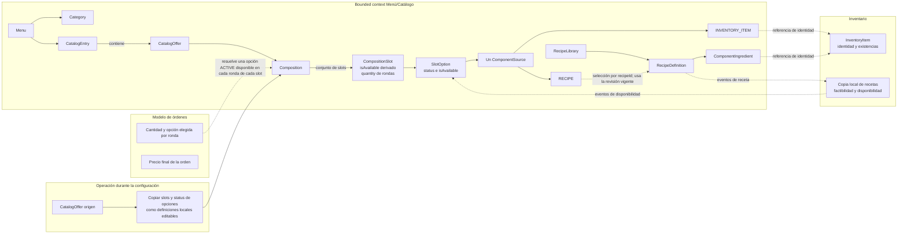
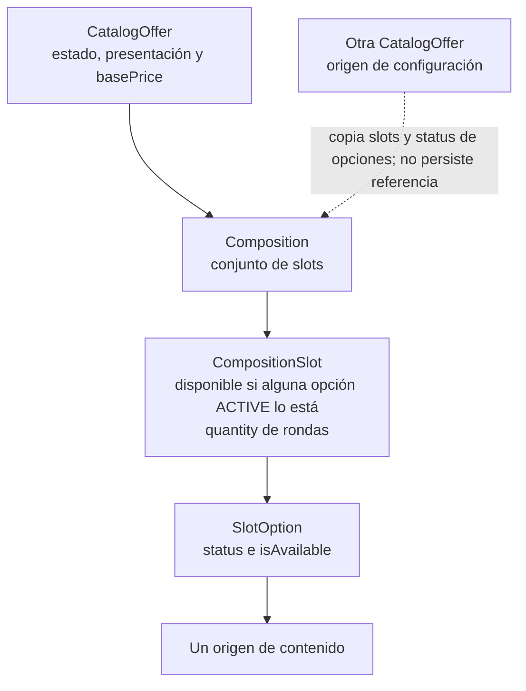

# Contexto, alcance y lenguaje del dominio

## Responsabilidad del bounded context Menú/Catálogo

El bounded context Menú/Catálogo define la identidad comercial de las entradas de la carta, las ofertas asociadas a cada entrada y la composición de cada oferta. También administra las categorías del menú y las recetas que el catálogo utiliza para describir elaboraciones.

El modelo organiza esta responsabilidad en tres niveles:

1. **Identidad comercial:** `Menu` contiene categorías y entradas. `CatalogEntry` conserva la identidad de un producto de la carta, sus categorías y sus ofertas.
2. **Oferta vendible:** cada `CatalogOffer` concreta pertenece a una `CatalogEntry` y se selecciona y vende individualmente. Cada oferta define su precio base y una `Composition`.
3. **Composición y contenido:** una composición es el conjunto que contiene uno o más slots (`CompositionSlot`). Cada slot contiene una o más opciones (`SlotOption`) que describen el contenido posible.

El nombre visible combina el `brandName` de `CatalogEntry` con el `presentationTag` obligatorio de `CatalogOffer`. La etiqueta describe la oferta concreta. Cada recurso separa dos conceptos: el `status` (estado administrativo), que decide si se muestra, y la disponibilidad (`isAvailable`), que decide si se puede ordenar. `CatalogEntry` tiene `status` `ACTIVE`, `INACTIVE` o `ARCHIVED`; `CatalogOffer` y `SlotOption` tienen `ACTIVE` o `INACTIVE`; `CompositionSlot` no tiene `status`. Los cuatro recursos tienen `isAvailable` derivado, que nadie asigna a mano y que se recalcula y se recupera solo. Lo `ACTIVE` se muestra; lo que no tiene `isAvailable` aparece deshabilitado y no se puede ordenar. Solo el administrador cambia el `status`; ni los eventos de Inventario ni los cambios de composición lo modifican (BR-MENU-032, BR-MENU-033).

### Composición y selección

- Cada oferta contiene exactamente una composición, formada por uno o más slots (`CompositionSlot`). Una composición válida contiene al menos un slot.
- Cada `CompositionSlot` contiene una o más `SlotOption`. Todo slot es obligatorio y participa en la selección. El slot tiene `isAvailable` si al menos una opción `ACTIVE` lo tiene; basta un slot sin disponibilidad para que la oferta no la tenga.
- `CompositionSlot.quantity` indica cuántas rondas de selección tiene el slot. En cada ronda se resuelve exactamente una opción `ACTIVE` con `isAvailable` de ese slot; si solo tiene una, se resuelve directamente en cada ronda. Por ejemplo, un slot de acompañamientos con `quantity` 3 tiene tres rondas, y en cada una se elige una opción `ACTIVE` con `isAvailable` entre papas, aros de cebolla y nuggets. Si ninguna opción `ACTIVE` está disponible, el slot no está disponible y la oferta no se puede ordenar, sin que cambie su `status`.
- `course` es opcional; cuando está presente, admite únicamente `entrada`, `plato fuerte`, `postre` o `bebida` y sugiere un tiempo de servicio.
- Durante la configuración, se puede elegir otra `CatalogOffer` como origen para copiar sus slots y opciones a la composición destino. La copia conserva el `status` de las opciones; la disponibilidad de cada slot se recalcula. Las opciones `RECIPE` copiadas siguen la revisión vigente de su receta. Las definiciones quedan locales, independientes y editables. La oferta destino no conserva el ID ni una referencia a la oferta origen, no sincroniza cambios con ella y no copia su precio.

### Contenido y recetas

Cada `SlotOption` es una aparición contextual con exactamente un `ComponentSource`: `INVENTORY_ITEM` o `RECIPE`. Varias opciones pueden referir el mismo artículo o la misma definición de receta en apariciones distintas.

Catálogo administra las `RecipeDefinition` en `RecipeLibrary` y sus líneas `ComponentIngredient`. Una receta define nombre, descripción, instrucciones en texto, número de revisión y uno o más ingredientes seleccionados de Inventario, cada uno con su cantidad. Todas las recetas se almacenan en la biblioteca; si esta se comparte entre varios menús o tiene alcance de un solo menú permanece pendiente en OPEN-003. Al configurar un `CompositionSlot`, se puede seleccionar una receta existente únicamente por ID o crear una receta desde ese flujo. Una receta nueva se guarda primero en `RecipeLibrary`. La opción guarda en `RecipeSource` solo el ID de la receta, sin indicar una revisión, y usa siempre su revisión vigente. La definición asignada no se modifica desde la opción. Al editar una opción que ya usa receta, omitir el ID conserva la receta asignada.

Cada línea `ComponentIngredient` referencia exactamente un `InventoryItem` e indica la cantidad física de ese ingrediente. Al seleccionar, consultar o editar la línea se muestra su unidad de medida autoritativa, suministrada por Inventario; la unidad de la cantidad debe ser compatible con la del artículo. Una receta se crea con la revisión 1; editarla crea una nueva revisión, con el número siguiente, que pasa a ser la vigente y que las opciones vigentes usan de inmediato; las revisiones anteriores se conservan como historial consultable. Las cantidades físicas de artículos e ingredientes son distintas de `CompositionSlot.quantity`, que expresa rondas de selección del slot.

La definición vigente de una receta solo puede eliminarse cuando ninguna `SlotOption` de ninguna oferta la referencia, incluso si la oferta o la opción está inactiva. Si existe una referencia, se rechaza la eliminación sin cambios. Su historial de revisiones se conserva y permanece consultable.

Una oferta `INACTIVE` no se presenta a quien no administra el catálogo. La entrada conserva su `status` cuando cambian el `status` o la disponibilidad de una oferta; si no tiene ofertas disponibles, aparece deshabilitada. Archivar una entrada desde `ACTIVE` o `INACTIVE` la retira del flujo normal sin modificar los estados de sus ofertas; desarchivarla la deja en `INACTIVE`.

Una `CatalogEntry` solo puede eliminarse cuando está `ARCHIVED`. Una `CatalogOffer` solo puede eliminarse individualmente cuando está `INACTIVE`; la disponibilidad no interviene. Usar otra oferta como origen de configuración no crea una referencia vigente entre ofertas ni añade una condición de eliminación. La operación se rechaza íntegramente cuando no se cumplen sus condiciones, sin modificar recursos dependientes. Las composiciones, slots y opciones poseídos exclusivamente pueden eliminarse junto con su propietario.

### Precio declarado por Catálogo

`CatalogOffer.basePrice` es fijo para la oferta, independientemente de los slots y opciones de su composición. Los slots, sus opciones y la oferta seleccionada como origen de una copia no aportan cargos automáticos ni trasladan precios al precio base.

El catálogo declara `basePrice`. La cantidad pedida, las opciones concretas resueltas en cada ronda según la cantidad de cada slot y el cálculo del precio final pertenecen al modelo de órdenes.

## Ownership y límites de contexto

| Ámbito | Responsabilidad del dominio |
| :--- | :--- |
| Menú/Catálogo | Es propietario de `Menu`, `Category`, `CatalogEntry`, `CatalogOffer`, sus composiciones, slots, opciones y recetas; declara los precios base, rige el `status` administrativo, deriva `isAvailable` y emite eventos de receta para Inventario. |
| Inventario | Es propietario de la identidad, unidad de medida y existencias de `InventoryItem`. Catálogo lo referencia como concepto externo en opciones y recetas. Mantiene una copia local de las recetas recibida por eventos de Menu, comprueba la factibilidad de las recetas y la disponibilidad de los artículos, y lo comunica a Menu por eventos; el contrato queda pendiente en OPEN-011. |
| Órdenes | Registra la cantidad pedida y la opción concreta elegida en cada ronda definida por la cantidad de cada slot; determina el precio final de la orden según el modelo transaccional. |

La validez estructural de una composición o receta corresponde a sus definiciones de catálogo. El stock de los artículos referenciados pertenece a Inventario y es independiente de esa validez. La factibilidad y la disponibilidad comunicadas por Inventario solo determinan `isAvailable`.

La conexión desde `CatalogOffer origen` representa una operación de configuración: al concluir la copia, la composición destino no mantiene una relación con esa oferta. Todo slot genera sus rondas según `quantity`. La disponibilidad del slot y de la oferta se recalcula a partir de las opciones copiadas sin cambiar el `status` de la oferta ni el de la entrada.

## Lenguaje para describir una oferta

Una oferta se describe desde la identidad de la carta hasta las opciones que pueden ocupar cada slot:

Todo slot participa en la selección y genera el número de rondas indicado por su `quantity`; en cada ronda se resuelve una opción `ACTIVE` con `isAvailable`, directamente cuando solo hay una o por elección cuando hay varias. Si un slot no está disponible, la oferta aparece deshabilitada y conserva su `status`. La vista describe definiciones de catálogo; las elecciones concretas se registran en el modelo de órdenes.

## Glosario del dominio

- **`status`:** estado administrativo que decide si un recurso se muestra y que solo cambia el administrador.
- **`isAvailable`:** booleano derivado que decide si se puede ordenar; se recalcula a partir de los eventos de Inventario y de la composición.
- **`Menu`:** ámbito propietario de las categorías y entradas comerciales.
- **`Category`:** clasificación reutilizable del menú que puede relacionarse con varias entradas.
- **`CatalogEntry`:** identidad comercial de un producto de la carta; conserva `brandName`, categorías y sus ofertas. Tiene `status` (`ACTIVE`, `INACTIVE` o `ARCHIVED`) e `isAvailable` derivado, que es `true` si tiene al menos una oferta `ACTIVE` disponible.
- **`CatalogOffer`:** oferta concreta de una entrada, seleccionable y vendible individualmente; tiene `status` `ACTIVE` o `INACTIVE`, `isAvailable` (todos sus slots disponibles), `presentationTag` obligatorio, `basePrice` y exactamente una composición. Se muestra bajo una entrada `ACTIVE`.
- **`Composition`:** conjunto de uno o más slots que define la composición de una oferta.
- **`CompositionSlot`:** slot obligatorio de una composición, con una o más opciones y una `quantity` que indica su número de rondas. No tiene `status`; tiene `isAvailable` si tiene al menos una opción `ACTIVE` disponible.
- **`SlotOption`:** aparición contextual que contiene un origen único; tiene `status` e `isAvailable`. Las opciones `INACTIVE` no se ofrecen como elegibles.
- **`ComponentSource`:** tipo conceptual que identifica el origen único de una opción: `INVENTORY_ITEM` o `RECIPE`.
- **`InventoryItemSource`:** contenido que referencia un artículo externo de Inventario con su cantidad física y unidad.
- **`RecipeSource`:** referencia interna desde una `SlotOption` a una receta de `RecipeLibrary` mediante `recipeId`, sin revisión: la opción usa siempre la revisión vigente. Al configurar una opción `RECIPE`, se elige una receta solo por ID o se define una nueva, que se guarda primero en la biblioteca. Cuando la receta recibe una revisión nueva, la opción la usa de inmediato.
- **`InventoryItem`:** artículo cuya identidad, unidad de medida y existencias pertenecen a Inventario.
- **`RecipeLibrary`:** biblioteca administrada por Catálogo que almacena las definiciones de receta; su alcance entre menús permanece pendiente en OPEN-003.
- **`RecipeDefinition`:** receta con nombre, descripción, instrucciones en texto, revisión y una o más líneas de ingredientes de Inventario; se crea con la revisión 1 y cada edición crea una revisión nueva con el número siguiente, que pasa a ser la vigente; las anteriores se conservan como historial consultable.
- **`ComponentIngredient`:** línea de receta que referencia un `InventoryItem`, conserva la cantidad indicada y muestra la unidad autoritativa de Inventario.
