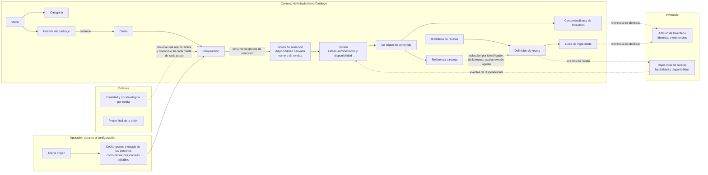
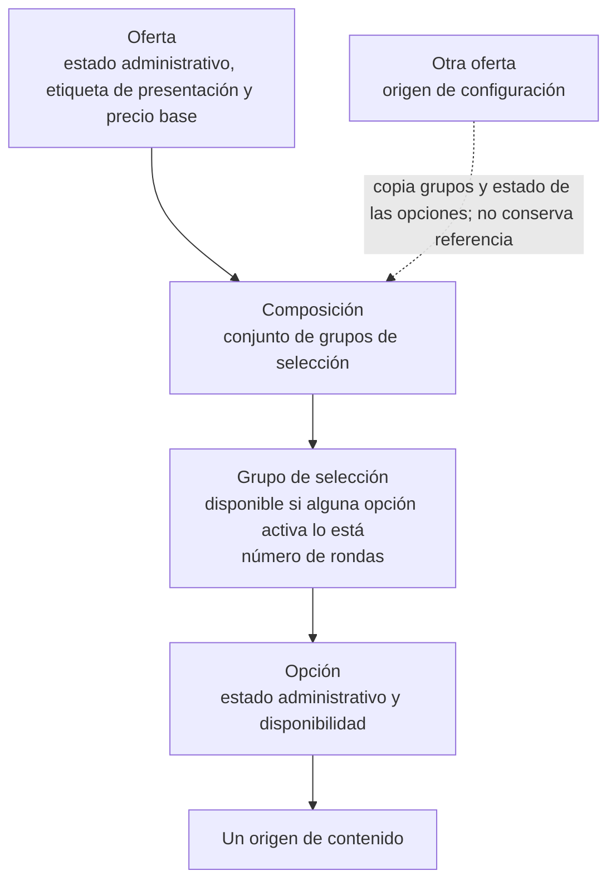

# Contexto, alcance y lenguaje del dominio

## Responsabilidad del contexto delimitado Menú/Catálogo

El contexto delimitado Menú/Catálogo define la identidad comercial de las entradas del catálogo, las ofertas de cada entrada y la composición de cada oferta. También administra las categorías del menú y las recetas que el catálogo utiliza para describir elaboraciones. Los requisitos que precisan estas responsabilidades se enumeran en el [índice de requisitos funcionales](functional-requirements.md); esta sección los resume sin repetir sus criterios.

El modelo organiza esta responsabilidad en tres niveles:

1. **Identidad comercial:** el menú contiene categorías y entradas; cada entrada conserva su nombre comercial, sus categorías y sus ofertas ([`requirements/categorias-y-entradas.md`](requirements/categorias-y-entradas.md)).
2. **Oferta vendible:** cada oferta pertenece a una entrada, se selecciona y se vende individualmente, y declara su precio base y una composición ([`requirements/ofertas.md`](requirements/ofertas.md)).
3. **Composición y contenido:** la composición reúne uno o más grupos de selección, y cada grupo contiene opciones que describen el contenido posible ([`requirements/composicion.md`](requirements/composicion.md) y [`requirements/opciones.md`](requirements/opciones.md)).

El nombre visible de la oferta combina el nombre comercial de la entrada con la etiqueta de presentación de la oferta (RF-CONS-02). Cada recurso separa dos conceptos: el estado administrativo, que decide si se muestra, y la disponibilidad, que decide si se puede ordenar. El estado administrativo solo lo cambia el administrador (RF-GEN-04); la disponibilidad es un valor derivado que el sistema recalcula ([`requirements/disponibilidad.md`](requirements/disponibilidad.md)). Las entradas, ofertas y opciones activas se presentan a quien consulta el catálogo, y las no disponibles aparecen deshabilitadas y no pueden ordenarse (RF-CONS-01). Las imágenes de entradas y ofertas se cargan antes de crear el recurso y se cambian reemplazando su archivo ([`requirements/imagenes.md`](requirements/imagenes.md)).

### Composición y selección

- La validez de la composición se define en RF-COMP-01: es estructural y no depende de la disponibilidad ni de las existencias.
- Los grupos de selección son obligatorios y participan en la selección (RF-COMP-02); cada uno indica su número de rondas (RF-COMP-03) y, opcionalmente, un tiempo de servicio sugerido (RF-COMP-04).
- Las opciones elegibles en cada ronda y la opción predeterminada se definen en RF-COMP-05 y RF-COMP-06, y el orden de presentación, en RF-COMP-07. Por ejemplo, un grupo de selección de acompañamientos con tres rondas ofrece en cada ronda una elección entre papas, aros de cebolla y nuggets.
- La disponibilidad de los grupos de selección y de las ofertas se deriva conforme a RF-DISP-02 y RF-DISP-03.
- La composición se actualiza parcialmente (RF-COMP-08 a RF-COMP-11) o se completa con copias de los grupos y opciones de otra oferta (RF-COMP-12); la copia no crea una relación persistente con la oferta origen.

### Contenido y recetas

Cada opción tiene un único origen de contenido: contenido directo de Inventario o receta (RF-OPC-07, RF-OPC-08). Las opciones con receta la asignan por su identificador o la crean durante la configuración, y usan siempre su revisión vigente (RF-OPC-09, RF-OPC-10).

El catálogo guarda las recetas en la biblioteca de recetas ([`requirements/recetas.md`](requirements/recetas.md)). Una receta reúne nombre, descripción, instrucciones y líneas de ingrediente que referencian artículos de Inventario; cada edición crea una revisión nueva y las anteriores se conservan como historial consultable (RF-REC-04 a RF-REC-06). La eliminación de una receta se rige por RF-REC-07. Si la biblioteca se comparte entre varios menús o tiene alcance de un solo menú queda pendiente en [OPEN-003](open.md#open-003--alcance-de-la-biblioteca-de-recetas).

La cantidad física de artículos e ingredientes se expresa en la unidad que Inventario establece para el artículo y es distinta del número de rondas de un grupo de selección (RF-COMP-03, RF-INTG-02).

El ciclo de vida de entradas y ofertas (creación, activación, inactivación, archivado, desarchivado y eliminación) se describe en los requisitos de entradas y de ofertas; los efectos de cada cambio de estado sobre los demás recursos se rigen por RF-GEN-04.

### Precio declarado por el catálogo

El catálogo declara el precio base de cada oferta, que no se deriva de su composición ni se toma de la oferta origen de una copia (RF-OFE-03, RF-COMP-12). La cantidad pedida, las opciones elegidas en cada ronda y el cálculo del precio final pertenecen a Órdenes.

## Propiedad de los datos y límites de contexto

| Ámbito | Responsabilidad del dominio |
| :--- | :--- |
| Menú/Catálogo | Es propietario del menú, las categorías, las entradas, las ofertas, sus composiciones, grupos de selección y opciones, y las recetas; declara los precios base, rige el estado administrativo, deriva la disponibilidad y emite eventos de receta para Inventario (RF-INTG-05). |
| Inventario | Es propietario de la identidad, la unidad de medida y las existencias de cada artículo de Inventario (RF-INTG-02). Valida de forma síncrona los artículos que Menu referencia (RF-INTG-01). Como dependencia externa, mantiene una copia local de las recetas recibida por eventos de Menu, comprueba la factibilidad de las recetas y la disponibilidad de los artículos, y lo comunica a Menu por eventos (RF-INTG-03, RF-INTG-04); el contrato queda pendiente en [OPEN-011](open.md#open-011--contrato-de-eventos-con-inventario). |
| Órdenes | Registra la cantidad pedida y la opción elegida en cada ronda de cada grupo de selección; comprueba las elecciones de la orden (RF-CONS-05.CA2), determina el precio final y conserva su propia copia de los datos de la oferta al aceptar la orden. |

La validez estructural de una composición o de una receta corresponde a sus definiciones en el catálogo (RF-COMP-01). Las existencias de los artículos referenciados pertenecen a Inventario y son independientes de esa validez; la factibilidad y la disponibilidad que comunica Inventario solo determinan la disponibilidad (RF-DISP-01).

La conexión desde la oferta origen representa una operación de configuración: al concluir la copia, la composición destino no mantiene una relación con esa oferta (RF-COMP-12). La disponibilidad de los grupos de selección, de la oferta y de su entrada se recalcula a partir de las opciones copiadas, sin cambiar el estado administrativo de la oferta ni el de la entrada.

## Lenguaje para describir una oferta

Una oferta se describe desde la identidad de la carta hasta las opciones que pueden elegirse en cada grupo de selección:

Todo grupo de selección participa en la selección y genera el número de rondas que indica; en cada ronda se elige una opción activa y disponible, directamente cuando es la única elegible (RF-COMP-02, RF-COMP-05, RF-COMP-06). Si un grupo no está disponible, la oferta se presenta deshabilitada y conserva su estado administrativo. Esta vista describe definiciones del catálogo; las elecciones concretas se registran en Órdenes.

## Exclusiones de alcance

- Menu no administra menús: opera un menú por sucursal, según el alcance operativo de [`configuration.md`](configuration.md).
- Menu no registra auditoría de los cambios administrativos (autor, fecha, valores anteriores); Órdenes conserva su propia copia de los datos de la oferta al aceptar la orden. El historial de revisiones de recetas (RF-REC-05) no es una auditoría.
- Menu no emite eventos de cambios del catálogo a sus consumidores, que obtienen los datos mediante consulta bajo demanda conforme a RF-CONS-05.CA1.
- Las longitudes máximas y los formatos de los textos, la idempotencia de los reintentos y la paginación de las consultas pertenecen al contrato de API.
- La autenticación de quien solicita y la asignación de capacidades corresponden a un servicio externo, conforme a RF-GEN-01.CA4.

## Glosario del dominio

Cada término remite al requisito que lo regula; la norma se enuncia solo en ese requisito.

- **Estado administrativo:** estado de una entrada, una oferta o una opción que decide si se presenta y que solo cambia el administrador (RF-GEN-04).
- **Disponibilidad:** valor derivado que decide si un recurso se puede ordenar o elegir; el sistema la recalcula a partir de los eventos de Inventario y de la composición (RF-DISP-01 a RF-DISP-06).
- **Ordenable:** condición de una oferta que puede pedirse en una orden (RF-DISP-05).
- **Menú:** ámbito propietario de las categorías y de las entradas del catálogo (RF-CAT-01, RF-ENT-01).
- **Categoría:** clasificación del menú que puede agrupar varias entradas (RF-CAT-01 a RF-CAT-04).
- **Agrupación «sin categoría»:** agrupación en la que figuran las entradas que no tienen categorías (RF-CAT-04).
- **Entrada (entrada del catálogo):** identidad comercial de un producto de la carta, con su nombre comercial, descripción, imagen, categorías y ofertas (RF-ENT-01).
- **Nombre comercial:** identidad comercial autoritativa de una entrada (RF-ENT-01).
- **Oferta:** producto vendible de una entrada, seleccionable individualmente, con su etiqueta de presentación, precio base, imagen y composición (RF-OFE-01).
- **Etiqueta de presentación:** texto que describe la presentación concreta de una oferta (RF-CONS-02).
- **Nombre visible de la oferta:** nombre que resulta del nombre comercial de la entrada y de la etiqueta de presentación de la oferta (RF-CONS-02).
- **Precio base:** precio que el administrador declara para la oferta completa (RF-OFE-03).
- **Composición:** conjunto de grupos de selección de una oferta (RF-COMP-01).
- **Composición válida:** composición que cumple las condiciones estructurales de RF-COMP-01.
- **Grupo de selección:** miembro obligatorio de una composición que contiene opciones y genera rondas (RF-COMP-02).
- **Número de rondas:** cantidad de rondas que genera un grupo de selección, distinta de la cantidad física de un artículo o ingrediente (RF-COMP-03).
- **Ronda:** cada una de las elecciones de una opción dentro de un grupo de selección (RF-COMP-05).
- **Tiempo de servicio:** momento sugerido de servicio de un grupo de selección; sus valores admitidos se definen en RF-COMP-04.
- **Opción:** aparición contextual de un contenido dentro de un grupo de selección (RF-OPC-06).
- **Nombre mostrado:** nombre de una opción en su contexto (RF-OPC-06).
- **Opción elegible:** opción que puede elegirse en una ronda (RF-COMP-05).
- **Opción predeterminada:** opción que se usa directamente en un grupo de selección en los casos de RF-COMP-06.
- **Origen de contenido:** contenido único de una opción, que es contenido directo de Inventario o receta (RF-OPC-07).
- **Contenido directo de Inventario:** origen de contenido que referencia un artículo de Inventario con su cantidad (RF-OPC-08).
- **Receta (definición de receta):** elaboración de la biblioteca de recetas con nombre, descripción, instrucciones y líneas de ingrediente; «definición de receta» la distingue de sus revisiones (RF-REC-01).
- **Revisión (revisión vigente):** cada estado numerado de una receta; la revisión vigente es la que usan las opciones (RF-REC-04, RF-OPC-09).
- **Historial de revisiones:** conjunto de las revisiones anteriores de una receta (RF-REC-05, RF-REC-06).
- **Biblioteca de recetas:** lugar donde el catálogo guarda las recetas; su alcance entre menús queda pendiente en [OPEN-003](open.md#open-003--alcance-de-la-biblioteca-de-recetas) (RF-REC-01).
- **Línea de ingrediente:** línea de una receta que referencia un artículo de Inventario con su cantidad (RF-REC-02).
- **Artículo de Inventario:** artículo cuya identidad, unidad de medida y existencias pertenecen a Inventario (RF-INTG-02).
- **Existencias:** cantidad física de un artículo que administra Inventario y no Menu (RF-INTG-02).
- **Imagen (identificador de la imagen):** archivo cargado de forma previa que se asocia a una entrada o a una oferta mediante su identificador (RF-IMG-01, RF-IMG-03).
- **Reemplazo del archivo de una imagen:** operación que sustituye el archivo de una imagen existente; el identificador de la imagen no cambia (RF-IMG-05).
- **Capacidad de administrar y capacidad de consultar:** permisos que distinguen al administrador de quien consulta el catálogo (RF-GEN-01).
- **Versión del recurso:** dato que identifica el estado vigente de un recurso y que se indica en cada modificación o eliminación (RF-GEN-02).

## Tabla de correspondencia técnica

Esta tabla y la vista técnica de [`architechture.md`](architechture.md) son los únicos lugares de la ERS con nombres de código. La unidad de medida es solo la del artículo de Inventario: la línea de ingrediente y el contenido directo de Inventario no tienen una unidad propia (RF-OPC-08, RF-REC-02).

| Término formal | Nombre técnico |
| :--- | :--- |
| menú | `Menu` |
| categoría | `Category` |
| entrada del catálogo | `CatalogEntry` |
| nombre comercial | `brandName` |
| oferta | `CatalogOffer` |
| etiqueta de presentación | `presentationTag` |
| precio base | `basePrice` |
| composición | `Composition` |
| grupo de selección | `CompositionSlot` |
| número de rondas (del grupo de selección) | `quantity` |
| tiempo de servicio | `course` |
| opción | `SlotOption` |
| nombre mostrado | `displayName` |
| origen de contenido | `ComponentSource` |
| tipo de origen artículo de Inventario | `INVENTORY_ITEM` |
| contenido directo de Inventario | `InventoryItemSource` |
| tipo de origen receta | `RECIPE` |
| referencia a receta | `RecipeSource` |
| identificador de la receta | `recipeId` |
| biblioteca de recetas | `RecipeLibrary` |
| receta (definición de receta) | `RecipeDefinition` |
| línea de ingrediente | `ComponentIngredient` |
| artículo de Inventario | `InventoryItem` |
| identificador de la imagen | `imageId` |
| estado administrativo | `status` |
| activo, inactivo, archivado | `ACTIVE`, `INACTIVE`, `ARCHIVED` |
| disponibilidad | `isAvailable` |
